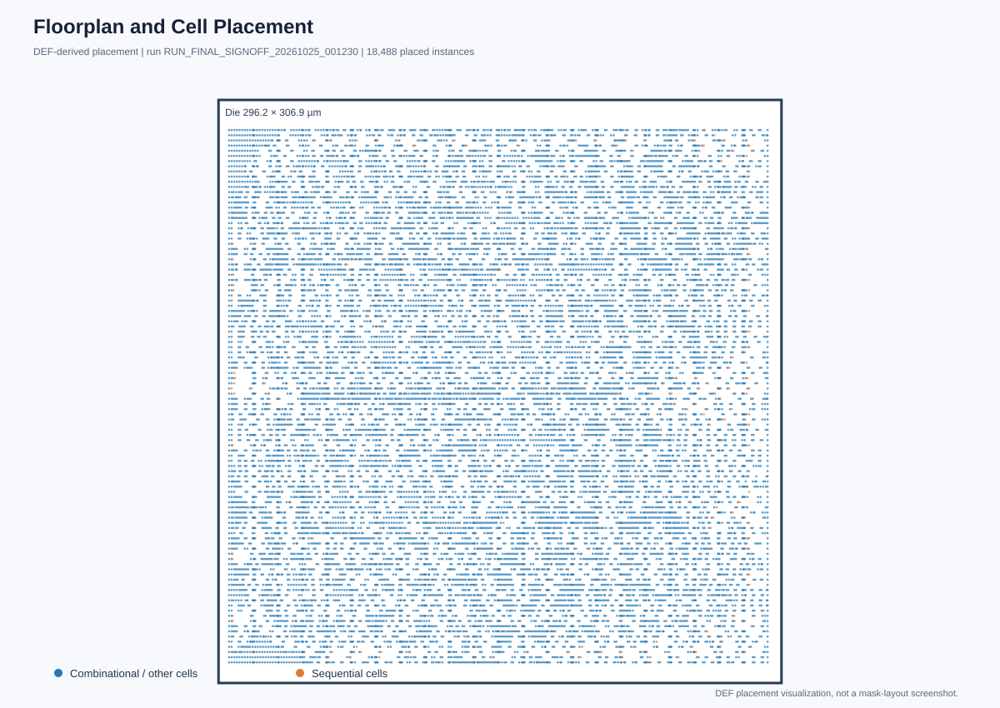
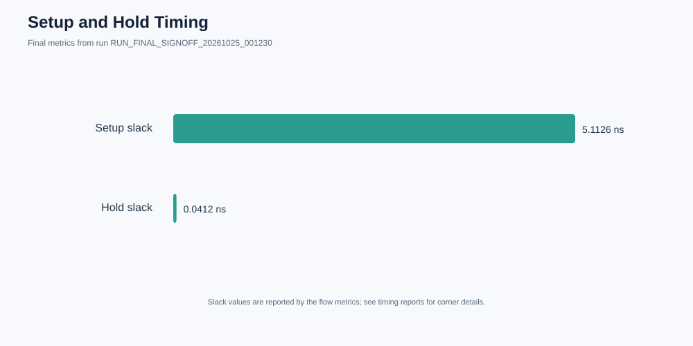

# Adaptive Low-Power Matrix-Multiplication Accelerator

[](https://github.com/vamsikrishnatheegela/adaptive-low-power-matrix-accelerator/actions/workflows/rtl-regression.yml)

A SystemVerilog portfolio project for a signed INT8 matrix-multiplication tile and adaptive low-power control. The RTL regression passes, and an OpenLane 2.3.10 SKY130A RTL-to-GDSII flow has completed. The physical low-power mechanisms remain control-plane models; see the [physical-design results and signoff gaps](docs/PHYSICAL_DESIGN_RESULTS.md).

## Contents
- `rtl/mac_tile_2x2.sv`: combinational signed INT8 2×2 matrix multiply.
- `rtl/matrix_accelerator.sv`: sequential start/busy/done wrapper around the tile.
- `rtl/adaptive_power_manager.sv`: power-state and operating-point control-plane FSM.
- `tb/`: self-checking testbenches, including a 502-vector independent arithmetic scoreboard.
- `scripts/run_iverilog.sh`: reproducible simulation regression.
- `docs/`: architecture, roadmap, results template, and [physical-design results](docs/PHYSICAL_DESIGN_RESULTS.md).
- `openlane_config.json`: reproducible OpenLane configuration for the integrated top module.

## Run
Requirements: Icarus Verilog (`iverilog`, `vvp`), Bash; GNU Make is optional.

```bash
bash scripts/run_iverilog.sh
# or
make test
```

The script builds in a temporary directory and removes artifacts on exit. The independent arithmetic scoreboard uses a fixed seed for reproducibility.

## Datapath
For signed 2×2 matrices, `C=A×B`. Each input is signed 8-bit; each output is signed 17-bit, sufficient for the sum of two signed 8×8 products:
```text
c00 = a00*b00 + a01*b10    c01 = a00*b01 + a01*b11
c10 = a10*b00 + a11*b10    c11 = a10*b01 + a11*b11
```
This is a small verification-friendly starting point, not a production accelerator.

## Low-power implementation boundaries
- `compute_enable` is an enable intent, not a gated clock. ASIC implementation should use a library ICG cell or supported clock-gating transformation; do not AND a clock with a combinational signal.
- `power_domain_on` is a request, not a physical power switch. Real power gating needs power switches, isolation, reset/retention policy, sequencing, and supported power intent such as UPF.
- DVFS is modeled through operating-point request/acknowledge. RTL alone does not change voltage or guarantee safe clock frequencies.
- Report only measured tool outputs; do not invent area, timing, power, or energy savings.

## Project status
| Feature | Status |
|---|---|
| Signed INT8 2×2 tile | Baseline RTL included |
| Datapath testbench | Directed/random test (103 vectors); independent scoreboard (502 vectors) |
| Power-manager FSM | Baseline RTL and testbench passing in CI |
| Sequential start/busy/done wrapper | RTL and testbench passing in CI |
| ICG mapping / physical gated clock | Not implemented; enable intent only |
| UPF, switches, isolation, retention | Not implemented; power control is a model |
| Physical DVFS | Not implemented; request/ack control-plane model only |
| Generic synthesis | Completed with Yosys; generic cell count is not physical area |
| OpenLane RTL-to-GDSII | Flow completed; GDS/DEF/LEF generated, LVS and DRC passed |
| Physical signoff | Open: antenna and electrical-rule checks must be clean in a rerun with the current SDC/configuration |

See [architecture](docs/ARCHITECTURE.md), [roadmap](docs/ROADMAP.md), [results template](docs/RESULTS_TEMPLATE.md), and [physical-design results](docs/PHYSICAL_DESIGN_RESULTS.md).

<!-- AUTO_RTL_TO_GDS_STATUS_START -->

## Latest RTL-to-GDS Physical Design Status

**Status: RTL-TO-GDS SIGNOFF CHECKS PASSED.**

**Run tag:** `RUN_FINAL_SIGNOFF_20261025_001230`  
**Flow:** PASS — complete  
**GDS:** Generated

| Check | Result |
|---|---|
| RTL regression | PASS |
| RTL-to-GDS flow | PASS — complete |
| GDS | Generated |
| Final antenna check | PASS (0 violations) |
| Maximum slew | PASS (0 violations) |
| Maximum capacitance | PASS (0 violations) |
| Maximum fanout | PASS (0 violations) |
| Setup timing | PASS (5.1126 ns slack) |
| Hold timing | PASS (0.0412 ns slack) |
| LVS | PASS |
| DRC | PASS |

### Physical-design visuals

Floorplan and placed-cell overview from the final DEF:



Global-routing resource usage by layer (not a detailed-routing heatmap):


Setup and hold slack from final flow metrics:



Detailed summary: [`reports/rtl_to_gds/latest_summary.md`](reports/rtl_to_gds/latest_summary.md).
Evidence bundle: `reports/rtl_to_gds/RUN_FINAL_SIGNOFF_20261025_001230/`. Original implementation run: `runs/RUN_FINAL_SIGNOFF_20261025_001230`.

### Tool warnings retained for review

- `[18:42:55] WARNING  [RSZ-0020] found 2 floating nets.            ]8;id=433525;file:///nix/store/7zqpr7slgvjfjcqfabb2fmlpvc8k23ax-python3-3.13.9-env/lib/python3.13/site-packages/librelane/steps/openroad.py\openroad.py]8;;\:]8;id=921566;file:///nix/store/7zqpr7slgvjfjcqfabb2fmlpvc8k23ax-python3-3.13.9-env/lib/python3.13/site-packages/librelane/steps/openroad.py#314\314]8;;\`
- `[18:43:47] WARNING  [GRT-0243] Unable to repair antennas on net  ]8;id=405672;file:///nix/store/7zqpr7slgvjfjcqfabb2fmlpvc8k23ax-python3-3.13.9-env/lib/python3.13/site-packages/librelane/steps/openroad.py\openroad.py]8;;\:]8;id=794782;file:///nix/store/7zqpr7slgvjfjcqfabb2fmlpvc8k23ax-python3-3.13.9-env/lib/python3.13/site-packages/librelane/steps/openroad.py#314\314]8;;\`
- `[18:45:27] WARNING  Threshold for Threshold-surpassing long wires ]8;id=275881;file:///nix/store/7zqpr7slgvjfjcqfabb2fmlpvc8k23ax-python3-3.13.9-env/lib/python3.13/site-packages/librelane/steps/checker.py\checker.py]8;;\:]8;id=141485;file:///nix/store/7zqpr7slgvjfjcqfabb2fmlpvc8k23ax-python3-3.13.9-env/lib/python3.13/site-packages/librelane/steps/checker.py#108\108]8;;\`
- `[18:45:34] WARNING  'VSRC_LOC_FILES' was not given a value,     ]8;id=825976;file:///nix/store/7zqpr7slgvjfjcqfabb2fmlpvc8k23ax-python3-3.13.9-env/lib/python3.13/site-packages/librelane/steps/openroad.py\openroad.py]8;;\:]8;id=71235;file:///nix/store/7zqpr7slgvjfjcqfabb2fmlpvc8k23ax-python3-3.13.9-env/lib/python3.13/site-packages/librelane/steps/openroad.py#2249\2249]8;;\`
- `[18:46:41] WARNING  [Checker.LintWarnings] 447 Lint warnings found.  ]8;id=538144;file:///nix/store/7zqpr7slgvjfjcqfabb2fmlpvc8k23ax-python3-3.13.9-env/lib/python3.13/site-packages/librelane/flows/flow.py\flow.py]8;;\:]8;id=90446;file:///nix/store/7zqpr7slgvjfjcqfabb2fmlpvc8k23ax-python3-3.13.9-env/lib/python3.13/site-packages/librelane/flows/flow.py#701\701]8;;\`
- `[18:46:41] WARNING  [OpenROAD.IRDropReport] 'VSRC_LOC_FILES' was not ]8;id=411136;file:///nix/store/7zqpr7slgvjfjcqfabb2fmlpvc8k23ax-python3-3.13.9-env/lib/python3.13/site-packages/librelane/flows/flow.py\flow.py]8;;\:]8;id=797813;file:///nix/store/7zqpr7slgvjfjcqfabb2fmlpvc8k23ax-python3-3.13.9-env/lib/python3.13/site-packages/librelane/flows/flow.py#701\701]8;;\`

<!-- AUTO_RTL_TO_GDS_STATUS_END -->
